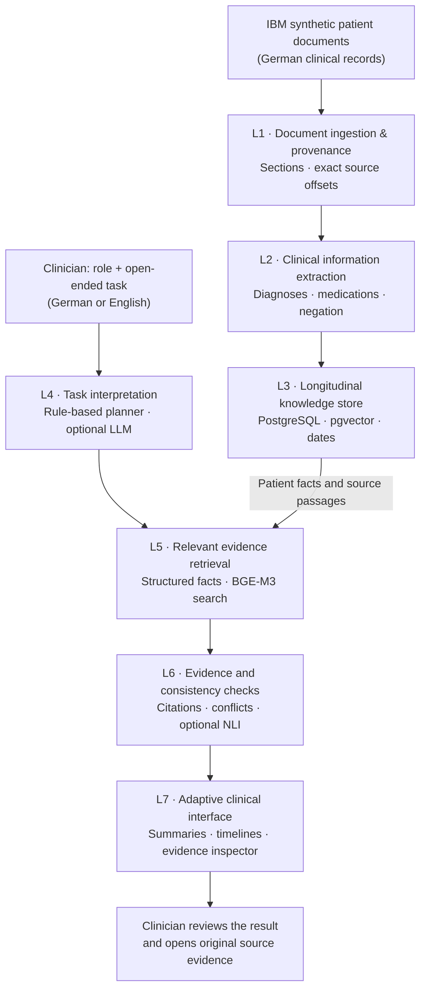

# Lumen Clinical

**The right patient information, for the right clinician, with evidence you can check.**

**Healthcare Hackathon Vienna 2026 · Track 1: Clinical Documentation**  
**[Open the live demo](https://screenshot-stitchery-studio.lovable.app)** · [Scientific report](docs/SCIENTIFIC_REPORT.md)

## The problem

A patient's story is scattered across clinical letters, medication lists and reports. Finding what matters for a specific clinical task takes time. Records may disagree, and missing information can be mistaken for a documented negative finding.

## Our solution

**Lumen Clinical** turns German medical documents into a task-focused, evidence-linked clinical workspace. A clinician can describe **any role and question** in German or English. Lumen retrieves relevant information, brings together the patient's history, flags conflicting or missing details, and links findings to the **exact passages in the original documents**.

**It supports clinical review; it does not replace clinical judgment.**

## Try it in the demo

1. **Preoperative review (German):** Role: `Anästhesistin` · Task: `Präoperative Abklärung: Allergien, Antikoagulation, Raucherstatus und relevante Herzbefunde?`
2. **Cancer treatment (English):** `What is the planned breast cancer treatment and when, and what are the receptor status and Ki-67?`
3. **Check the evidence:** Click any citation to see the original German text and highlighted source span; explore medication changes and record conflicts.
4. **Optional claim checker:** Open **Verify clinical statement** to check whether a statement is supported, contradicted or not addressed by the record.

## What it can do

- **Task-adaptive summaries:** Different clinical roles and questions surface different information.
- **Source-linked answers:** Click citations to inspect the original record, not just an AI-generated summary.
- **Longitudinal overview:** Explore diagnoses, events and medication lists across documents.
- **Discrepancy detection:** See conflicting values, dates and medication instructions.
- **Missing-information alerts:** Distinguish *not documented* from *documented absent*.
- **Human-in-the-loop review:** Review flagged findings; optionally verify a statement with multilingual NLI.

## How it works — seven layers

**Technology:** Python / FastAPI · medSpaCy + German ConText rules · PostgreSQL + pgvector · BGE-M3 multilingual retrieval · optional multilingual NLI verification · React / TypeScript / Lovable · Docker / Exoscale.

## Early evaluation

On **one synthetic IBM patient (8 documents)**, our internal evaluation found:

- **Passage fact recall@10:** BGE-M3 dense retrieval **57%** versus **9%** for keyword-only retrieval (28 bilingual queries).
- **Claim checking:** **0 false-supported claims** in a small 34-claim evaluation with deterministic checks plus multilingual NLI; contradiction recall was **55%**.

These are **preliminary, small-sample engineering results**, not evidence of clinical safety or generalization. See the [scientific report](docs/SCIENTIFIC_REPORT.md) for methods, baselines and limitations.

## Scope and limitations

This is a **research prototype using synthetic hackathon data**, not a medical device. A *supported* claim means that it matches the cited record, **not that it has been clinically verified**. Advanced NLI verification is optional; the main response prioritizes speed and strict source integrity. The demo does not implement hospital-grade authentication or patient authorization.

**Project resources:** [Scientific report](docs/SCIENTIFIC_REPORT.md) · [Demo runbook](docs/DEMO_RUNBOOK.md) · [Windows backup setup](docs/WINDOWS_SETUP.md) · [Security limitations](docs/SECURITY_AND_AUTH.md)
