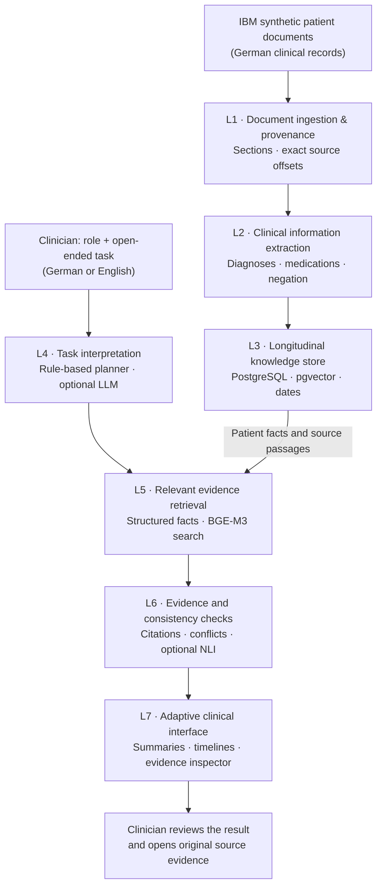

# Lumen Clinical

**The right patient information, for the right clinician, with evidence you can check.**

**Healthcare Hackathon Vienna 2026 · Track 1: Clinical Documentation**  
**[Open the live demo](https://screenshot-stitchery-studio.lovable.app)** (live FastAPI backend on Exoscale, Vienna) · [IBM judging results](docs/JUDGING_RESULTS.md) · [Scientific report](docs/SCIENTIFIC_REPORT.md)

## The problem

A patient's story is scattered across clinical letters, medication lists and reports. Finding what matters for a specific clinical task takes time. Records may disagree, and missing information can be mistaken for a documented negative finding.

## Our solution

**Lumen Clinical** turns German medical documents into a task-focused, evidence-linked clinical workspace. A clinician can describe **any role and question** in German or English. Lumen retrieves relevant information, brings together the patient's history, flags conflicting or missing details, and links findings to the **exact passages in the original documents**.

**It supports clinical review; it does not replace clinical judgment.**

## Try it in the demo

To reproduce the five official IBM scenarios, follow [docs/DEMO_SCRIPT_IBM.md](docs/DEMO_SCRIPT_IBM.md). A two-minute walkthrough script is in [docs/DEMO_VIDEO_SCRIPT.md](docs/DEMO_VIDEO_SCRIPT.md).

1. **Preoperative review (German):** Role: `Anästhesistin` · Task: `Präoperative Abklärung: Allergien, Antikoagulation, Raucherstatus und relevante Herzbefunde?`
2. **Cancer treatment (English):** `What is the planned breast cancer treatment and when, and what are the receptor status and Ki-67?`
3. **Check the evidence:** Click any citation to see the original German text and highlighted source span; explore medication changes and record conflicts.
4. **Optional claim checker:** Open **Verify clinical statement** to check whether a statement is supported, contradicted or not addressed by the record.

## What it can do

- **Task-adaptive summaries:** Different clinical roles and questions surface different information.
- **Source-linked answers:** Click citations to inspect the original record, not just an AI-generated summary.
- **Longitudinal overview:** Explore diagnoses, events and medication lists across documents.
- **Discrepancy detection:** See conflicting values, dates and medication instructions.
- **Missing-information alerts:** Distinguish *not documented* from *documented absent*.
- **Human-in-the-loop review:** Review flagged findings; optionally verify a statement with multilingual NLI.

## How it works — seven layers

**Technology actually running in the demo:**
- **Backend:** Python 3.11 / FastAPI.
- **Extraction:** rule-based German extraction with medSpaCy and German NegEx/ConText rules; local ATC/ICD-10/LOINC lexicons.
- **Storage:** PostgreSQL 16 + pgvector.
- **Retrieval:** BGE-M3 (`BAAI/bge-m3`) dense retrieval, plus structured fact queries.
- **Planning:** a rule-based task planner. An LLM planner exists but is off in the demo.
- **Verification:** deterministic citation-integrity checks in every response; optional multilingual NLI (`mDeBERTa-v3-base-xnli-multilingual-nli-2mil7`) on request.
- **Frontend:** React / TypeScript built with Lovable.
- **Hosting:** Docker Compose on one Exoscale VM, with Caddy HTTPS and a demo token.

Deferred and **not** in the demo: FHIR export, temporal knowledge graph, autonomous (ReAct) agent.

## IBM Track 1 audit (official 5 situations, 15 questions)

Deployed system: Bob **`b814c70`** on Exoscale with the published Lovable app, audited in the browser on 30 Oct 2026. Details: [docs/RELIABILITY_RESULTS.md](docs/RELIABILITY_RESULTS.md) (current) and [docs/JUDGING_RESULTS.md](docs/JUDGING_RESULTS.md) (first audit, `8acac85`).

| Metric | Result (`b814c70`, strict grading: answer visible without expanding anything) |
|---|---|
| Correct answers | **12/15 correct, 3 partial, 0 failed.** The three partials are missing qualifiers: "normal LV function" appears only in the source; "no later HbA1c" is not stated; the 67 kg weight shows the letter date, not the visit date. The first audit (12/15 under a more lenient reading) had 4.1, 4.2 and 5.1 partial or failed; all three are now correct. |
| Traceability | **100%**: every displayed fact is linked; 0 bad evidence links in all 27 audited tasks |
| Invented facts | **0 found** in the manual review of the answer facts |
| Contradictions | 8 flagged: 7 real, 1 false alarm (net +6); changes over time are not flagged |
| Slowest screen | **2.2 s** in the browser (target < 10 s); all five together 7.8 s |
| New tasks | 10 English/German tasks: same essential facts and citations in both languages. 12 edge cases: 11 pass, 1 partial |

## Early evaluation

On **one synthetic IBM patient (8 documents)**, our internal evaluation found:

- **Passage fact recall@10:** BGE-M3 dense retrieval **57%** versus **9%** for keyword-only retrieval (28 bilingual queries).
- **Claim checking:** **0 false-supported claims** in a small 34-claim held-out evaluation with deterministic checks plus multilingual NLI; contradiction recall **82%**, support recall 50%.
- **English ↔ German:** 5 new task pairs and 6 statement pairs, checked by hand: [docs/MULTILINGUAL_RESULTS.md](docs/MULTILINGUAL_RESULTS.md).
- **Reliability (deployed):** 12 edge cases (out-of-scope questions, requests to invent, missing vs. negative findings, synonyms), the `locale` parameter, and the assessment of an optional Gemini planner (not integrated): [docs/RELIABILITY_RESULTS.md](docs/RELIABILITY_RESULTS.md).

These are **preliminary, small-sample engineering results**, not evidence of clinical safety or generalization. See the [scientific report](docs/SCIENTIFIC_REPORT.md) for methods, baselines and limitations.

## Scope and limitations

This is a **research prototype using synthetic hackathon data**, not a medical device. A *supported* claim means that it matches the cited record, **not that it has been clinically verified**. Advanced NLI verification is optional; the main response prioritizes speed and strict source integrity. The demo does not implement hospital-grade authentication or patient authorization; the demo token is visible in the public web app and only keeps out casual traffic.

**Known gaps (deployed version):**
- Three answers lack a qualifier, listed in the audit table above.
- Conflicts show explanations with source buttons rather than side-by-side passages.
- Quoted negatives (e.g. "Kein Perikarderguß") are labelled "Documented", not "Documented negative".
- German answers keep English fact lines; headings, notices and all source quotes follow the requested language.
- Some screens include extra, older facts; time windows such as "from the June 2015 stay" are not parsed.
- Claim verification does not match English dosing wording ("three times daily") or the English contrast-allergy phrasing; these come back as "not documented", never as a false confirmation.
- Out-of-scope detection uses word lists.
- Everything was evaluated on **one synthetic patient**. The 15 questions and the edge-case tasks informed the rules, so they are regression tests, not held-out validation.

**Project resources:** [IBM judging results](docs/JUDGING_RESULTS.md) · [IBM demo script](docs/DEMO_SCRIPT_IBM.md) · [Video script](docs/DEMO_VIDEO_SCRIPT.md) · [Scientific report](docs/SCIENTIFIC_REPORT.md) · [Demo runbook](docs/DEMO_RUNBOOK.md) · [Windows backup setup](docs/WINDOWS_SETUP.md) · [Security limitations](docs/SECURITY_AND_AUTH.md)
