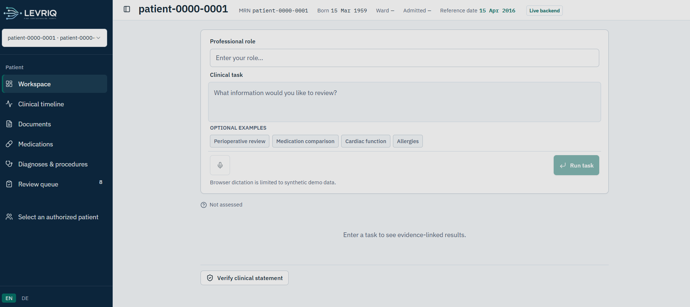
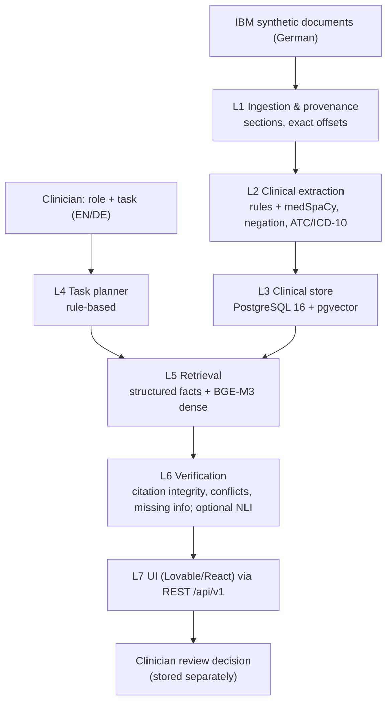

# LEVRIQ



**The right patient information for the right clinician, with evidence you can check.**

Healthcare Hackathon Vienna 2026 · **Track 1: Clinical Documentation** (IBM synthetic patient) · Repository: **LEVRIQ**

**[Live demo](https://screenshot-stitchery-studio.lovable.app)** · [Track 1 metrics](docs/TRACK1_METRICS.md) ·
[Blind evaluation](docs/ADVERSARIAL_EVAL.md) · [Scientific report](docs/SCIENTIFIC_REPORT.md) ·
Frontend repo: [screenshot-match](https://github.com/jromero158486/screenshot-match)

## Problem and solution

A patient's history is spread across German letters, reports and medication lists. Finding what matters for one
clinical task takes time. Records disagree, and "not documented" is easily mistaken for "documented absent".

Lumen Clinical takes a **free-text role and task** (English or German) and builds a task-specific screen from the
patient's documents. Every fact links to the **exact passage in the original German document**. Missing
information is listed separately from documented negatives, conflicting passages are flagged, and a clinician
records the final review decision. Lumen supports clinical review; it does not replace clinical judgement.

## What is implemented (and deployed)

- **Task-specific answers** for any role and task, in English or German (headings and notices follow the request
  language; source quotes stay in the original German).
- **Source citations** at character-offset level, checked automatically on every response.
- **Longitudinal history:** medications compared across stays, a timeline, and value series (weight, blood pressure).
- **"Not documented" vs. "documented negative"**, and **conflict detection** (e.g. a BMI that does not match the
  height and weight, two admission dates, left vs. right).
- **Out-of-scope handling:** questions unrelated to the record get an explanation instead of patient data.
- **Human-in-the-loop review** (see below) and an optional **"Verify clinical statement"** check (multilingual NLI).

**Not implemented:** FHIR export, a temporal knowledge graph, an autonomous agent, user authentication. An LLM
planner exists in the code but is **off** in production; no LLM is used at runtime.

## Architecture: seven layers



| Layer | Code | What it does |
|---|---|---|
| L1 | `backend/app/layer1_ingestion` | Reads IBM JSON documents, splits them into sections and keeps exact character offsets for every passage. |
| L2 | `backend/app/layer2_extraction` | Extracts diagnoses, medications (dose, schedule), measurements, procedures and allergies with German rules, medSpaCy ConText/NegEx and local ATC/ICD-10/LOINC lexicons. |
| L3 | `backend/app/layer3_store` | Stores facts, evidence spans, embeddings and review decisions in PostgreSQL + pgvector (Alembic migrations). |
| L4 | `backend/app/layer4_planner` | Turns role + task into a plan of clinical concepts (EN/DE vocabulary, abbreviations), the response language and a scope check. |
| L5 | `backend/app/layer5_retrieval` | Queries structured facts and BGE-M3 dense passage search (lexical fallback, reported in the response). |
| L6 | `backend/app/layer6_verification` | Checks every citation against the source text, detects conflicts and missing items; optional NLI on request (`POST /api/v1/verify-statement`). |
| L7 | [screenshot-match](https://github.com/jromero158486/screenshot-match) | React/TypeScript app (built with Lovable). It renders the backend's blocks and opens the source document with the highlighted span. |

**How the components talk:** the browser calls the FastAPI REST API (`/api/v1`, OpenAPI in `docs/openapi.json`)
with a bearer demo token. The backend reads and writes PostgreSQL. It calls the internal model service over HTTP for
BGE-M3 embeddings and NLI. In production, Caddy terminates HTTPS and is the only public entry point; the database and
model service are private.

**Production stack:**
- Python 3.11, FastAPI, SQLAlchemy/Alembic.
- PostgreSQL 16 + pgvector.
- spaCy/medSpaCy.
- Models: `BAAI/bge-m3` (dense retrieval) and `MoritzLaurer/mDeBERTa-v3-base-xnli-multilingual-nli-2mil7` (optional
  NLI), both served on CPU. Reranker off (`RERANKER=none`).
- Frontend: React + TypeScript (Lovable).
- Hosting: Docker Compose on one Exoscale VM (Vienna, 4 vCPU / 8 GB) behind Caddy.

## Run it locally (Docker Compose)

Requirements: Docker with Compose v2, about 10 GB of free disk space (model weights about 4.5 GB), and the IBM
challenge ZIP.

1. **Provide the IBM data separately.** It is not in this repository and must never be committed. Unzip the
   challenge ZIP anywhere outside the repo. `IBM_DATA_DIR` must point to its `data` folder (the folder containing
   `patient-0000-0001/`). It is mounted read-only.
2. **Start the stack:**

```bash
git clone https://github.com/jromero158486/LEVRIQ.git && cd LEVRIQ
IBM_DATA_DIR=/path/to/AIM-hack-track1-shipit-main/data RERANKER=none docker compose up --build -d
curl -s localhost:8000/api/health        # {"status":"ok", ...}; the first start downloads models (several minutes)
curl -s localhost:8000/api/v1/patients   # patient-0000-0001, 8 documents
```

3. **Open the UI.** The production UI is in [screenshot-match](https://github.com/jromero158486/screenshot-match):

```bash
git clone https://github.com/jromero158486/screenshot-match.git && cd screenshot-match
printf 'VITE_CLINICAL_API_MODE=http\nVITE_CLINICAL_API_BASE_URL=http://localhost:8000/api/v1\n' > .env.local
npm install && npx vite dev --port 5173   # open http://localhost:5173
```

   Start the backend with `CORS_ORIGINS=http://localhost:5173`. This repo also contains a minimal fallback UI on
   http://localhost:8080.

| Variable | Default | Purpose |
|---|---|---|
| `IBM_DATA_DIR` | empty folder | Path to the IBM `data` folder (required to load the patient) |
| `HF_CACHE_DIR` | Docker volume | Reuse a local Hugging Face cache for the model weights |
| `RERANKER` | `bge-reranker-v2-m3` | Use `none` to match production (the reranker is slow on CPU) |
| `EMBED_THREADS` | `6` | CPU threads for embeddings |
| `RETRIEVAL_MODE` | `auto` | BGE-M3 dense when available, otherwise lexical (reported) |
| `PLANNER` / `LLM_PROVIDER` | `heuristic` / `none` | Rule-based planner; the optional LLM planner is off |
| `DEMO_API_TOKEN` | empty | If set, API calls need `Authorization: Bearer <token>` (frontend: `VITE_CLINICAL_API_TOKEN`) |
| `CORS_ORIGINS` | `http://localhost:8080` | Allowed browser origins |
| `POSTGRES_PASSWORD` | `clinical` | Database password (local only; change it for any hosted use) |

Tests (no IBM data needed): `python -m venv .venv && .venv/bin/pip install -e ".[api,clinical,dev]" && .venv/bin/pytest -q`
(101 passed, 2 skipped). Hosted setup: [deploy/exoscale/README.md](deploy/exoscale/README.md). Windows:
[docs/WINDOWS_SETUP.md](docs/WINDOWS_SETUP.md). Troubleshooting: [docs/DEMO_RUNBOOK.md](docs/DEMO_RUNBOOK.md).

## Reproduce the five official IBM scenarios

- **In the app:** for each situation in `cases/situations.md`, enter the role (Anaesthetist, Surgeon, General
  practitioner, Emergency physician, General practitioner) and paste the situation's title and description. Check
  the three questions without expanding anything. Step by step: [docs/DEMO_SCRIPT_IBM.md](docs/DEMO_SCRIPT_IBM.md).
- **Scripted:** `evaluation/judging/hosted_ibm_audit.py` sends the same requests to the live or local API. It saves
  the raw screens and latency and checks every citation. Command: [docs/TRACK1_METRICS.md](docs/TRACK1_METRICS.md#reproduce).

## Track 1 metrics (official definitions, production `b814c70`)

| Metric | Result | Target |
|---|---|---|
| Correct answers | **12 / 15 correct, 3 partial, 0 failed** (strict: visible without clicking) | 15 / 15 |
| Traceability | **100%** (463 facts, 755 links, 0 broken) | 100% |
| Invented facts | **1**: a false "atrial fibrillation" diagnosis extracted from a question in a Holter request (on 4 of 5 screens) | 0 |
| Contradictions | **+6** (7 real, 1 false alarm) | ≥ 5 |
| Load time | **2.16 s** slowest (browser) | < 10 s |

**On 20 new questions** written after the freeze ([blind evaluation](docs/ADVERSARIAL_EVAL.md)):
5 correct, 11 partial, 4 incorrect, 0 broken citations. Definitions, method, baselines, the retrieval/verification
experiments and the production audit: [docs/TRACK1_METRICS.md](docs/TRACK1_METRICS.md).

## Human-in-the-loop review

1. Layer 6 flags potential issues, such as conflicting values or dates; each becomes a review item.
2. In **Review**, the clinician opens each source passage (the original German text, highlighted).
3. They record a decision (approve, reject, escalate, or propose a correction) with a comment.
4. Decisions are stored in PostgreSQL with their history. The UI shows "Human reviewed · approved" after a refresh.
5. **Original documents are never changed.** A proposed correction is stored next to the source, not in it.

Reviewer identity is a fixed demo user (no authentication). In the deployed version, escalations and corrections
are saved but show as unreviewed after a refresh, and the sidebar counts reviewed items too. A tested fix is in
[LEVRIQ #4](https://github.com/jromero158486/LEVRIQ/pull/4) and
[screenshot-match #3](https://github.com/jromero158486/screenshot-match/pull/3); it is not deployed.

## Limitations, privacy and data use

- **Synthetic data only.** This is a research prototype and not a medical device. It is evaluated on **one**
  synthetic patient; the 15 official questions shaped the rules, so they are a regression benchmark. No clinical
  validation, and no claim of generalisation beyond the tested data.
- **Known errors:**
  - Question lines in reports can be extracted as findings (the false atrial-fibrillation diagnosis).
  - False premises in questions are not corrected explicitly.
  - Some absent items named in a question are not reported as "not documented".
  - Scope detection uses word lists, so it can refuse answerable abbreviation-only questions and miss misleading
    requests.
  - German screens keep English fact lines.
  - Conflicts are shown with links, not side by side.
- **Privacy and security:**
  - No user authentication or patient-level authorisation (the app refuses to start unless `CLINICAL_DEMO_ONLY=1`).
  - The demo token only keeps out casual traffic.
  - Voice input is mock-only.
  - The IBM `data` folder, `expected.json`, raw evaluation outputs (`artifacts/`), `.env` files and keys are
    git-ignored and not in this repository.
  - See [docs/SECURITY_AND_AUTH.md](docs/SECURITY_AND_AUTH.md).

**Documentation:** [Track 1 metrics](docs/TRACK1_METRICS.md) · [Blind evaluation](docs/ADVERSARIAL_EVAL.md) ·
[Production audit](docs/RELIABILITY_RESULTS.md) · [First audit](docs/JUDGING_RESULTS.md) ·
[EN/DE results](docs/MULTILINGUAL_RESULTS.md) · [Scientific report](docs/SCIENTIFIC_REPORT.md) ·
[IBM demo script](docs/DEMO_SCRIPT_IBM.md) · [Video script](docs/DEMO_VIDEO_SCRIPT.md)
